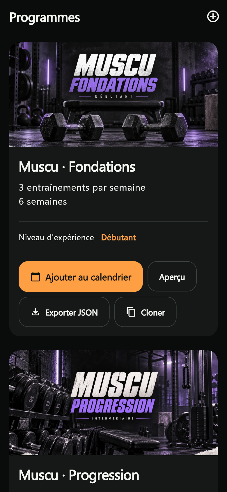
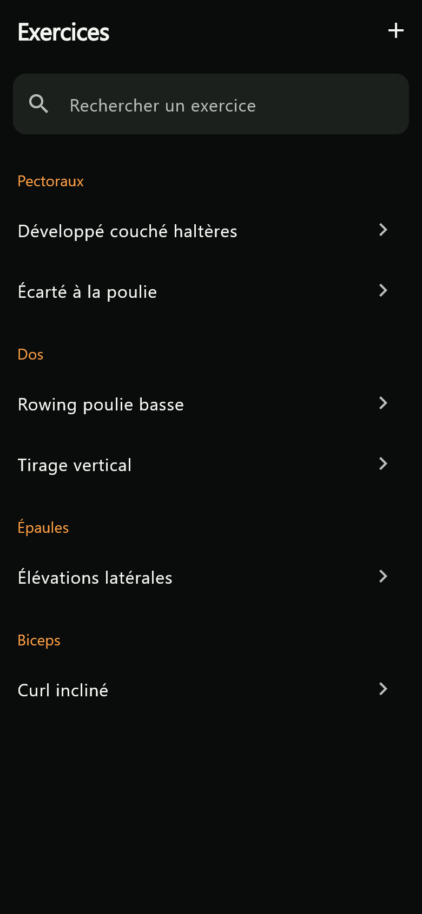
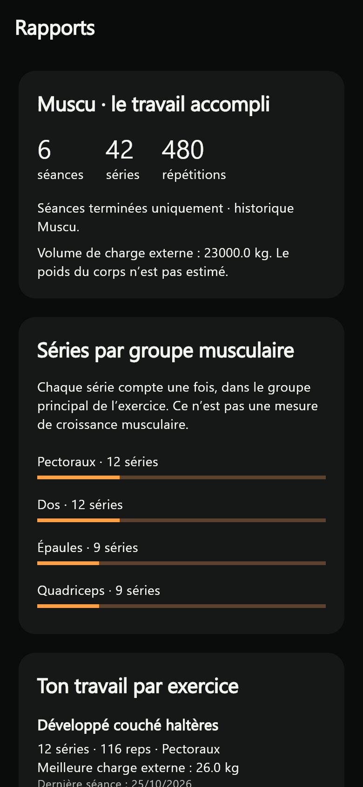
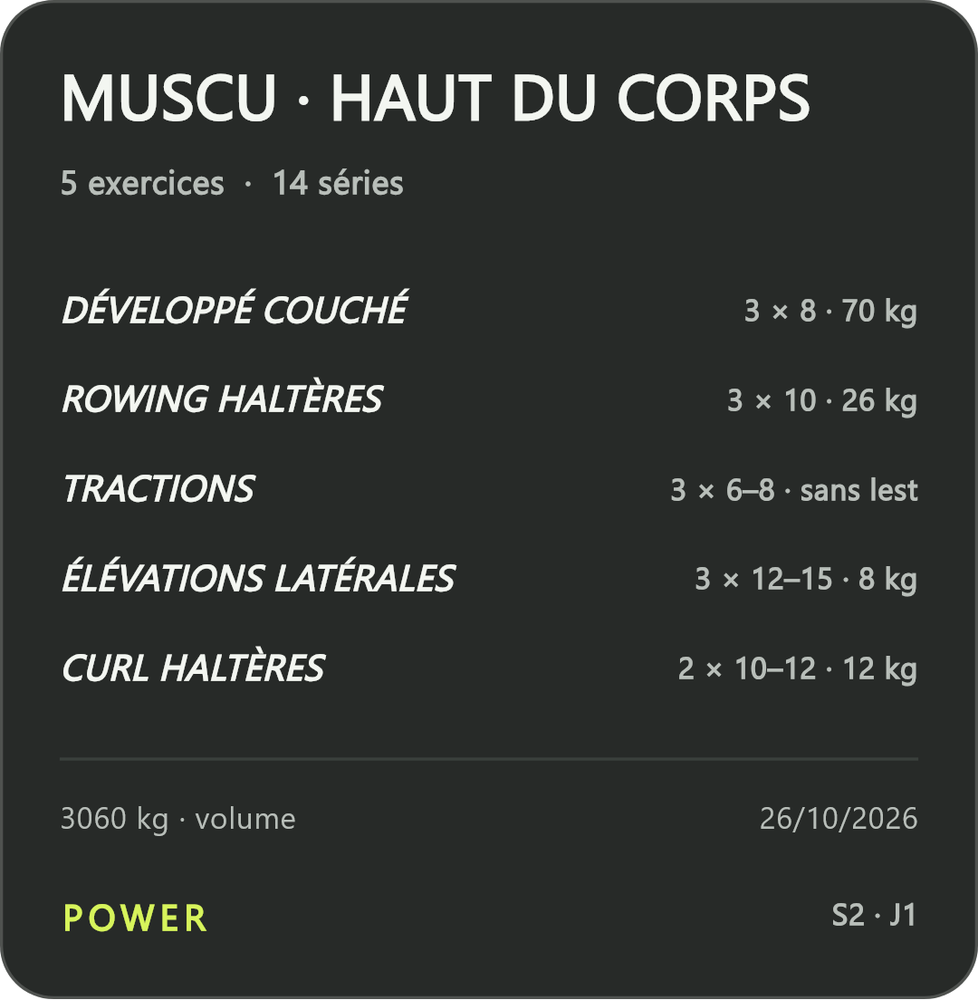
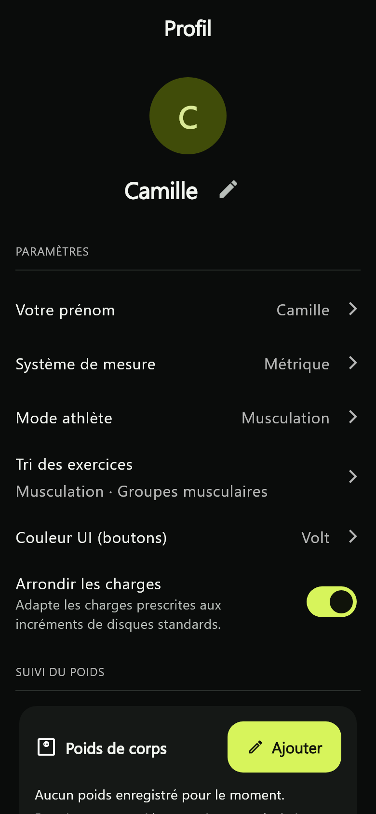
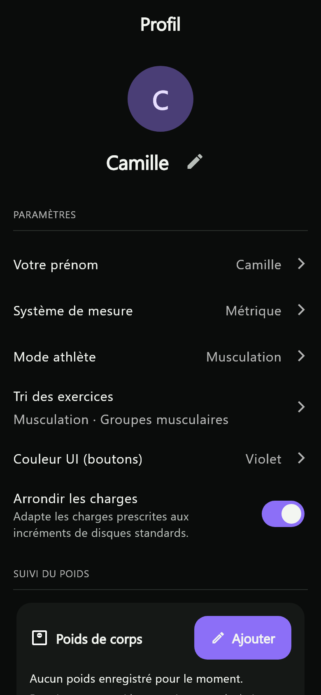
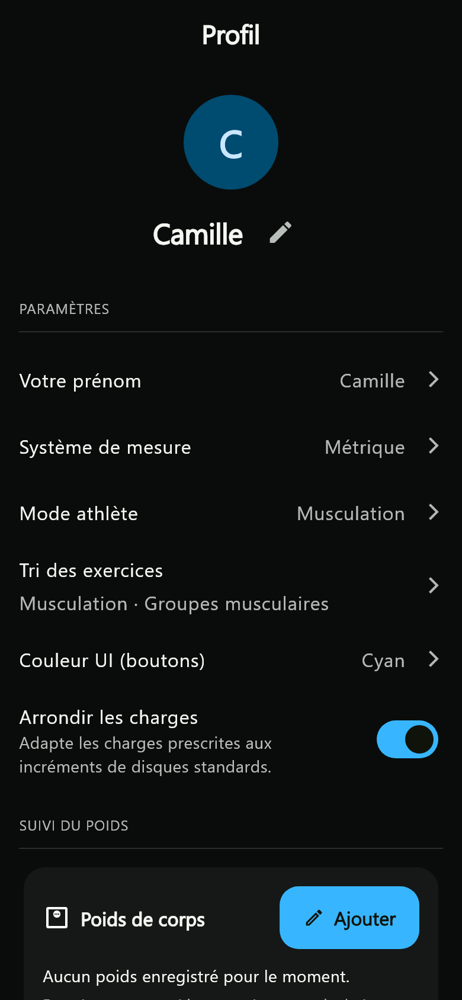
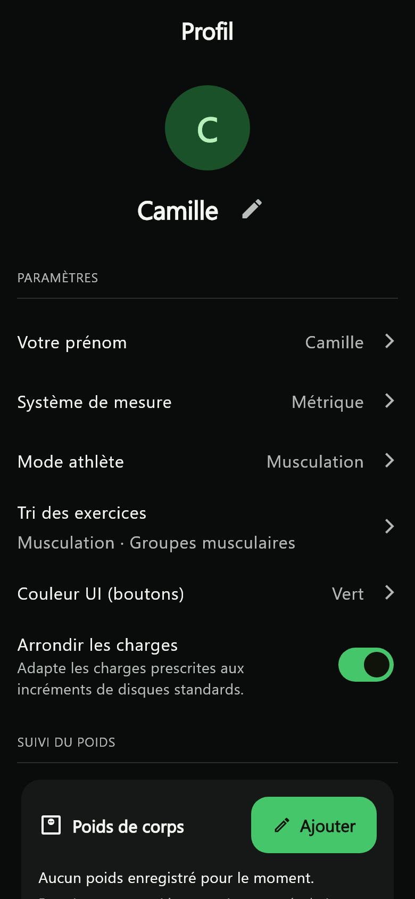
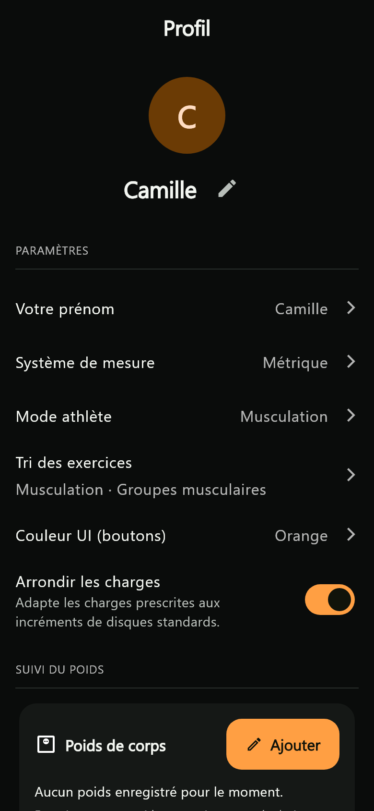
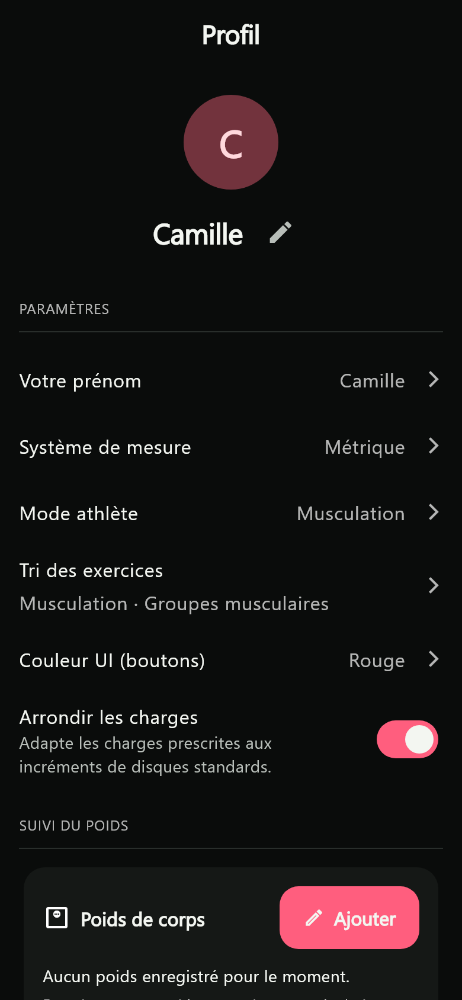

# Power

### Tes programmes. Tes séances. Ta progression.

Une application d’entraînement en français pour le **powerlifting**, la
**musculation** et le **street workout**.

[Télécharger la dernière version Android](https://github.com/GabGaabS/power-releases/releases/latest)
· [Voir toutes les versions](https://github.com/GabGaabS/power-releases/releases)
· [Signaler un problème](https://github.com/GabGaabS/power-releases/issues/new)

Power rassemble les programmes, le carnet de séance et les rapports dans une
application pensée pour être utilisée à la salle. Tu peux préparer ton cycle,
saisir tes séries, suivre tes performances et partager ta séance en story.
L’historique d’entraînement est enregistré sur ton appareil : une connexion
Internet n’est pas nécessaire pour enregistrer une séance.

Retrouve ici les **versions Android à installer**, les nouveautés et ce guide
pour découvrir les différents modes de Power.

## Aperçu

| Programmes | Exercices | Rapports |
| :---: | :---: | :---: |
|  |  |  |

*Captures de démonstration réalisées avec les écrans de Power et des données
fictives. La couleur d’accent et le contenu dépendent de tes réglages et de ton
entraînement.*

## Installer Power sur Android

1. Ouvre la [dernière release](https://github.com/GabGaabS/power-releases/releases/latest).
2. Dans **Assets**, télécharge le fichier `Power-…-android.apk`.
3. Ouvre le fichier depuis les téléchargements de ton téléphone.
4. Si Android le demande, autorise l’installation depuis ton navigateur ou ton
   gestionnaire de fichiers, puis confirme l’installation.
5. Lance Power, choisis ton mode athlète et prépare ta première séance.

Power se télécharge directement depuis cette page et n’est pas sur Google Play.
Chaque nouvelle version présente les nouveautés et le fichier à installer.

### Mettre l’application à jour

Depuis la version **6.5.0**, Power peut vérifier la présence d’une nouvelle
release. Le réglage de vérification se trouve dans **Profil**. Le téléchargement
et l’installation passent par Android, avec ton accord.

Tu peux aussi ouvrir cette page et télécharger le nouvel APK. Installe-le
**par-dessus la version existante**, sans désinstaller Power : c’est ce qui
permet de conserver les données locales. Une sauvegarde avant une mise à jour
reste une bonne habitude.

Si Android refuse la mise à jour, conserve l’application installée et signale
le message affiché. Une désinstallation supprimerait les données locales.

### Et sur iPhone ?

Ce dépôt distribue les APK **Android**. Un fichier APK ne s’installe pas sur
iPhone ; aucune distribution iOS n’est proposée ici.

## Choisir son mode : Power, Muscu ou Street

Choisis le mode qui correspond à ta pratique au premier lancement. Tu peux le
changer ensuite dans **Profil → Mode athlète**. Le mode adapte les programmes
proposés, le classement des exercices, les rapports et les badges.

Changer de mode ne supprime pas tes séances. Tes anciens entraînements restent
liés au programme et à la discipline dans lesquels tu les as réalisés.

### Power — travailler sa force

Prépare tes cycles autour du squat, du développé couché et du soulevé de terre.
Retrouve les charges prescrites, les séries, les répétitions et les ajustements
de séance. Ton **1RM de référence** est le maximum que tu choisis comme repère
pour les charges du programme. L’**e1RM** est une estimation obtenue à partir de
tes séries : tu peux comparer les deux et observer tes progrès.

Ce mode convient si tu veux structurer tes cycles autour des trois mouvements
et garder une trace de tes charges et de tes records.

### Muscu — organiser son travail musculaire

Organise tes séances par groupe musculaire et retrouve ton volume de travail,
tes répétitions et tes exercices dans les rapports Muscu. Deux programmes
intégrés sont disponibles : **Fondations**, pour débuter, et **Progression**,
pour un niveau intermédiaire.

Par défaut, les exercices sont regroupés par muscle pour retrouver facilement
les pectoraux, le dos, les épaules ou les jambes. Tu peux changer ce tri dans
**Profil → Tri des exercices**.

### Street — progresser au poids du corps et avec du lest

Enregistre tes tractions, dips et autres mouvements avec ou sans lest. Une
charge de **0 kg** représente une série sans lest ; Power n’ajoute pas un poids
de corps supposé au volume. Les programmes **Bases** et **Progression** couvrent
les niveaux débutant et intermédiaire.

Les rapports Street t’aident à suivre à la fois les répétitions sans lest et
les charges ajoutées. Les badges dédiés accompagnent cette progression.

Les quatre programmes Muscu et Street sont construits sur six semaines, avec
des consignes et une semaine allégée. Ce sont des bases à adapter à ton niveau,
à ton matériel et à ta récupération.

## Préparer ses programmes

- Créer un programme ou une séance avec l’éditeur visuel.
- Choisir un programme intégré et consulter son contenu avant de l’activer.
- Planifier les jours d’entraînement dans le calendrier.
- Ajouter un exercice existant ou en créer un directement depuis le sélecteur.
- Classer les exercices par **groupe musculaire** ou par **mouvement** ; le choix
  est mémorisé séparément pour chaque discipline.
- Modifier un programme et retrouver ses versions précédentes.
- Exporter un programme dans un **fichier complet** pour le conserver ou le
  partager, puis l’importer depuis un fichier quand tu en as besoin.

### Préparer un programme avec une IA externe

Dans **Programmes → Ajouter → Créer avec une IA**, retrouve des instructions
prêtes à copier dans l’outil de ton choix. Elles aident l’IA à te poser les
bonnes questions et à préparer un programme que Power peut importer.
Récupère le fichier obtenu puis importe-le depuis Programmes.

Power ne génère pas le programme dans l’app et n’envoie pas automatiquement ton
historique à une IA. Relis le résultat et adapte-le avant de l’utiliser.

## Pendant la séance

Retrouve tes exercices et tes séries, puis renseigne la charge, les répétitions
et le RPE si tu le souhaites. Le système métrique ou impérial s’applique à
l’affichage ; l’arrondi des charges est configurable.

Tu peux ajuster les exercices et les séries de la séance, garder un brouillon
et consulter les séances terminées. La sauvegarde locale passe avant les
fonctions sociales et les animations de récompense.

## Comprendre sa progression

- Historique des séances et calendrier d’entraînement.
- Rapports adaptés à la discipline du programme réellement effectué.
- Séries, répétitions, charge externe et répartition par groupe musculaire.
- Suivi des performances par exercice, des 1RM et des e1RM lorsqu’ils existent.
- Historique du poids de corps et outils GL Points.
- XP, progression et badges, dont des badges spécifiques Muscu et Street.

Les rapports prennent en compte les séances terminées. Les valeurs absentes,
comme un RPE non saisi, ne sont pas remplacées par des estimations dans les
exports.

## Partager sa séance

Prépare une image de séance, d’exercice ou de série depuis le partage.
La story présente une fiche sombre avec les exercices, les séries, les charges,
le volume et la date. Tu peux ajouter une photo choisie sur ton appareil ou
exporter la carte avec un fond transparent pour la superposer dans l’éditeur
de story de ton choix.

Le partage passe par la feuille de partage du téléphone. Tu gardes le choix
de la destination et de la publication. Une photo sélectionnée pour cette
composition reste traitée sur ton appareil.

## S’entraîner avec ses potes

L’onglet **Potes** permet de découvrir les profils publics, d’envoyer des demandes
d’amitié et de retrouver les statistiques que chacun choisit de partager.
Les commentaires et réactions hebdomadaires sont accessibles entre potes
acceptés, ainsi que sur ton propre profil. Les blocages et les réglages de
visibilité restent applicables.

Les fonctions sociales nécessitent une connexion. Un problème réseau ou un
refus de commentaire ne supprime pas tes séances locales.

## Données, confidentialité et sauvegardes

Les programmes, les séances, les séries et l’historique sont conservés sur ton
appareil. Les fonctions Potes utilisent Internet pour partager les informations
que tu choisis de rendre visibles. Tu peux modifier ces choix dans Profil.

**Les informations partagées avec tes potes ne remplacent pas une sauvegarde
complète de ton historique.**
Avant un changement de téléphone, une réinstallation ou une désinstallation,
exporte tes données depuis Profil et conserve la sauvegarde dans un autre
emplacement. Une désinstallation peut supprimer les données stockées par l’app.

Le profil permet de sauvegarder l’ensemble de tes données, uniquement tes
programmes ou tes musiques de performance. Pour partager un plan, l’export
depuis Programmes permet de transmettre le programme sans ton historique.

## Personnaliser l’application

Le thème graphite garde les séances lisibles à la salle. Le profil permet de
choisir une couleur d’accent, le mode athlète, le système de mesure, l’arrondi
des charges et le tri des exercices. Les écrans prennent en compte le texte
agrandi du téléphone. Les animations de badges peuvent être accélérées ou
passées lorsque plusieurs récompenses arrivent ensemble.

### Six couleurs d’accent

Choisis ta couleur dans **Profil → Couleur UI (boutons)**. Elle s’applique aux
boutons, aux sélections et aux éléments de progression. Le fond graphite reste
le même pour garder les séances lisibles.

| Volt | Violet | Cyan |
| :---: | :---: | :---: |
|  |  |  |

| Vert | Orange | Rouge |
| :---: | :---: | :---: |
|  |  |  |

## Signaler un problème ou proposer une idée

Ouvre un [ticket](https://github.com/GabGaabS/power-releases/issues/new) en précisant :

- la version de Power et la version d’Android ;
- le modèle du téléphone ;
- les étapes pour retrouver le problème ;
- le résultat attendu et ce qui s’affiche ;
- une capture si elle aide à comprendre, en masquant tes données personnelles.

Pour une idée, explique le besoin rencontré pendant ton entraînement et le
comportement souhaité. Les changements livrés sont décrits dans chaque release.

---

Power fournit un carnet et des outils d’entraînement. Les programmes intégrés
ne remplacent pas un accompagnement adapté à ta situation. Adapte les mouvements
à tes capacités et demande conseil à un professionnel si nécessaire.
